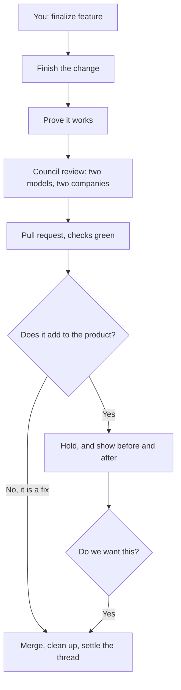

# Nstack

**Agent skills for getting work finished without watching it.** You say "finalize feature" and walk away. The agent tests the change, has two models from two companies review it, and merges it. It stops for you only when there is something a person should decide.

Works in Claude Code and Codex, and uses [T3 Code](https://github.com/pingdotgg/t3code) features where they exist. Largely inspired by [tstack](https://github.com/t3dotgg/tstack) by Theo Browne.

## Skills

| Skill | Say | What it does |
|---|---|---|
| `finalize-feature` | "finalize feature" | Takes a change to a tested, reviewed pull request. Merges fixes, holds additions for you. |
| `council-loop` | "council", "loop" | Two models from two companies review a change in rounds until both approve. |
| `modernize` | "modernize" | Rebases an old pull request and says honestly whether it should still exist. This one is Theo's, almost unchanged. |
| `agent-orchestrator` | (automatic) | Says which model gets which job, and how to hand work to Claude, Codex, local models and OpenRouter. |
| `hetzner` | (automatic) | Manages a Hetzner account with the `hcloud` CLI, and asks before anything that deletes or costs money. |

## The idea

> Fixes go through. Additions wait for a person.

A model is good at making a broken thing work. It is bad at deciding what a product should have. It finds a good reason for every addition, and a product gets worse one reasonable addition at a time.

So `finalize-feature` splits work in two. A fix merges on its own, also a visible one, like a button that is too small to hit. Anything the product did not have before is built, tested and reviewed, and then held until you have seen it.



A fix ends quietly: merged, branch deleted, thread closed. A held addition ends with a message like this one:

> **New: a rest timer on the workout screen.** It starts when you finish a set.
>
> *before.png · after.png*
>
> Held because it adds something new to the screen. Tested on the emulator, approved by the council in 2 rounds, checks green.
>
> Do we want this?

## Install

```bash
git clone https://github.com/NicolasMahn/Nstack
cp -R Nstack/skills/* ~/.claude/skills/   # Claude Code
cp -R Nstack/skills/* ~/.agents/skills/   # Codex
```

You need an authenticated [GitHub CLI](https://cli.github.com). `council-loop` needs a harness that can run a model from another provider as a subagent. T3 Code does this with `delegate_task`.

## Make it yours

The skills are written for me. They say "Nicolas" and name the models I trust, Sol and Opus. Change both. `agent-orchestrator` holds my own scores for the models and points at my [local model gateway](https://github.com/NicolasMahn/local_llm). Put in yours.

[AGENTS.md](AGENTS.md) is the instruction file every agent on my machine reads. It is here as an example, not as something to install. So do not run `install.sh` unless you want my whole setup: it links `AGENTS.md`, the skills, and the tools in `bin/` into the places Claude Code and Codex read, and that makes my instructions yours.

`hetzner` reads the API token from `~/.config/hetzner/api-token` and the account's private details from `~/.config/hetzner/account.env`. `agent-orchestrator` reads the address and key of the local model gateway from `~/.config/local-llm/account.env`. Nothing private is in this repo.

[MIT](LICENSE)
